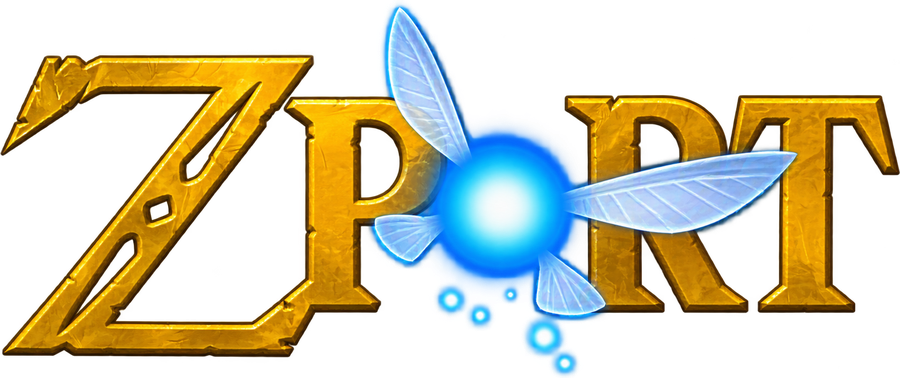

<h1 align="center">
   
  
   
</h1>

  
  
  

# Zport

Zport is an experimental static recompilation of **The Legend of Zelda: Ocarina of Time (Nintendo Switch 2)** that runs
natively on Windows and Linux, with no emulator. The game's code is translated to C and compiled into a Windows program,
the console's system software is reimplemented, and the Switch 2 graphics are rebuilt on Vulkan. All of this happens
**on your PC, from your own copy of the game**.

This is an independent fan project, not affiliated with or endorsed by Nintendo.

> [!IMPORTANT]
> This repository **does not contain the game, keys, firmware or an executable of the game**, and it does not explain how
> to get them. You need your own copy. Everything the build creates (`zport.exe`, the generated code, the shader caches
> and your saves) comes from your game and stays on your PC. Never share those files.

## Downloads and setup

Download Zport only from this repository's [releases page](https://github.com/them0ntes/Zport/releases). Zport has no
other download site: archives offered elsewhere are not built by this project.

1. Download the `ZportBuilder.zip` of the latest release and **extract the whole archive**. Keep the `tools` folder
   beside `Zport.exe`.
2. Run `Zport.exe` (Zport Builder). It unpacks and checks what it needs the first time.
3. Choose your game's `.nup`, or your `romfs` and `exefs` folders. The builder checks that it is the right version.
4. Choose a language and a folder for the finished game, and press **Build the game**. It takes about 40 minutes, once,
   and you can use your PC in the meantime.
5. When it finishes, press **Play**, or open `zport.exe` in the folder you chose.

Only use games and system files you legally obtained.

### What you need

- 64-bit Windows 10 or 11. Linux is available as an AppImage in the releases that include it.
- A graphics card with **Vulkan 1.3 and mesh shaders**, with an up-to-date driver. Only NVIDIA has been tested.
- 16 GB of RAM or more. A run uses about 10 GB.
- About 60 GB free while building.
- Your copy of the game at the supported version: program `0400486024DEC000`, update v131072, build `e0f3ccfa`.
  Other versions do not work.

Nothing else to install: Zport Builder brings its own compiler, Python and libraries.

### Updates

When Zport Builder opens and a newer release is out, **Update available** and an **Update** button appear at the top
right. It downloads the new version and builds your game folder again from the game files it keeps. Your saves and
settings stay: they live in the `user` folder beside `zport.exe` and in `zport_options.ini`. To be safe, copy your saves
before updating.

## Project status

Experimental. It has only been tested on **one PC** (Ryzen 5 7600X, RTX 4060 Ti 16 GB), mostly in the area at the start
of the game.

| What | Status |
|---|---|
| Kokiri Forest: reaching gameplay and walking around | ✅ Works |
| Sound, controller, keyboard and saves | ✅ Works |
| In-game menu, frame generation and upscaling | ✅ Works |
| Performance with frame generation (default 2x) | ✅ Aimed at 100–120+ shown |
| Performance without frame generation | ⚠️ About 50–60 fps walking |
| Ultrawide | ⚠️ The 3D keeps its shape, but the HUD is stretched |
| Hyrule Field and the rest of the game | ❓ Not tested yet |
| AMD and Intel cards | ❓ Never tested |

## In-game menu

Press <kbd>Insert</kbd> (or <kbd>F1</kbd>) in game, or on a controller the Home button. Your choices are saved in
`zport_options.ini` beside the game.

| Option | Choices |
|---|---|
| Quality preset | Custom, Minimum (4GB), Low (6GB), Balanced (8GB), High (12GB), Ultra (16GB+) |
| Frame generation | Off, 2x, 3x, 4x |
| Frame pacing | Off, On |
| Resolution | Auto, 100%, 75%, 67%, 50% |
| Upscaling | Off, Catmull-Rom, Lanczos |
| Sharpness | 0 to 100% |
| FPS counter | Off, On |

The **FPS counter** shows the game's real frame rate, its 1% low (the stutter an average hides) and, with frame
generation on, the frames shown.

## Compatibility and issue reports

Performance varies by hardware and driver. Rendering errors, stutters and crashes are still possible.

When you [report an issue](https://github.com/them0ntes/Zport/issues), include:

- The exact Zport version (the first line of `zport_log.txt`), your CPU, GPU and driver version.
- Where you were in the game and the steps to reproduce the problem.
- A screenshot or video, and the log, after checking it for personal information.

**Do not upload game files, keys, firmware or private account information.**

## Credits

Zport exists thanks to the work of many people:

- **NotRexed**: Zport, BlueShell (Mario Kart World), Skybound (Tears of the Kingdom) and the a64-kit tools.
- **[Eden](https://git.eden-emu.dev/eden-emu/eden)** and **Eglantine**: the shader recompiler and Switch 2 shader work.
- **suyu**: the graphics decoders and the AArch64 translator.
- **[seedds/nxnative](https://github.com/seedds/nxnative)**: reference for how task and mesh shaders work.
- **[EvilBoyce / evilmfkr](https://github.com/evilmfkr/Hookshot)** (EvilOOT): the GPU culling that brings back Kokiri's
  foliage, the ambient light probes, the pond's water, the game's own fog and the exposure flicker fix.
- **[zortos293/Lichii](https://github.com/zortos293/Lichii)**: reference for Ampere shader lowering.
- **[mstorsjo/llvm-mingw](https://github.com/mstorsjo/llvm-mingw)**: the bundled Windows compiler.
- **[kinnay/zbic](https://github.com/kinnay/zbic)**, **Opus** and **SDL**: decompression, audio and controllers.
- **[sostenesfreitas/ocarina-recomp](https://github.com/sostenesfreitas/ocarina-recomp)** and
  **[MythosOfs/Orchid](https://github.com/MythosOfs/Orchid)**: reference and the fog and exposure workaround.
- **Mesa (NAK)**: the reference for Ampere's instruction encoding.
- Everyone who sent fixes, among them SkippySteve, klimovich008, d3zessete, chrispository, vzeol, monsterlag,
  leonidasmark, Segmentree, Zorkats, ShyVortex, hiKareeem, gab9281 and i900gaming.

## License

Zport is free software under the [GNU General Public License, version 3 or later](LICENSE) (GPL-3.0-or-later). It
includes code from Eden, suyu and Orchid, which are under the GPL too.

The Legend of Zelda and Ocarina of Time are trademarks of Nintendo.
